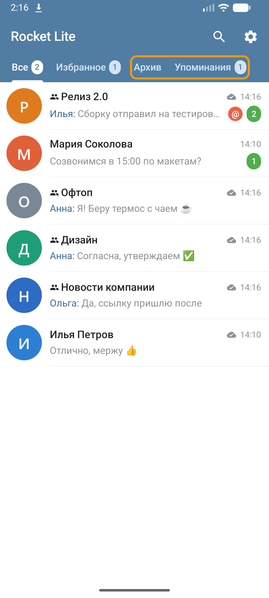
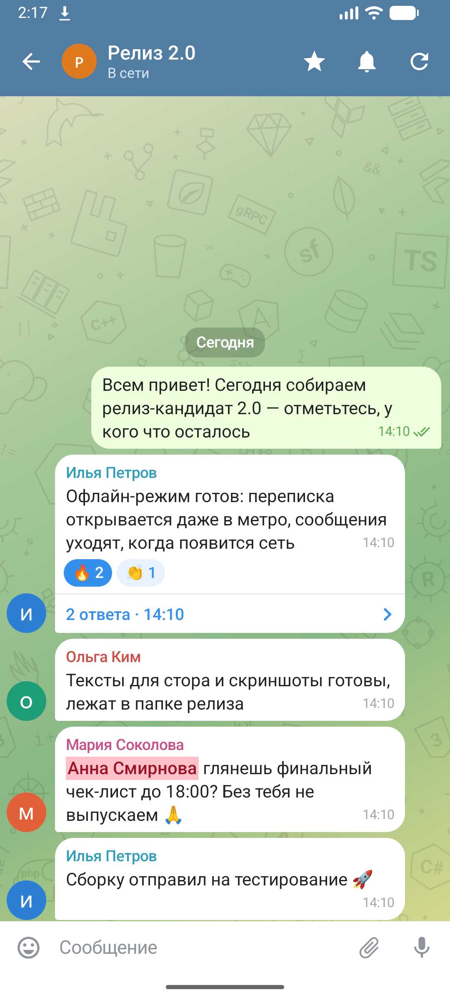
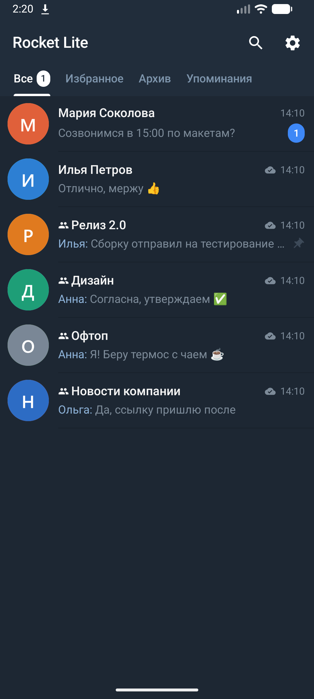

# Rocket Lite — быстрый клиент Rocket.Chat

## Скачать

**[Последняя версия](../../releases/latest)** · [все версии и что в них нового](../../releases)

| Система | Файл в релизе, в «Assets» |
|---|---|
| Windows 10/11 | `RocketLite-<версия>.msi` (если SmartScreen — «Подробнее» → «Выполнить в любом случае») |
| macOS (Apple Silicon) | `RocketLite-<версия>.dmg` (образ не подписан: при первом запуске правый щелчок по программе → «Открыть») |
| Ubuntu / Debian | `rocket-lite_<версия>_amd64.deb` |
| Android 8+ | `rocket-lite-<версия>.apk` |

Если для какой-то системы новая версия ещё не собрана (обычно macOS собирается чуть позже), в последнем релизе
лежит её прошлая версия — скачать можно всегда.

При первом запуске укажите адрес своего сервера Rocket.Chat и войдите под обычной учётной записью.

## Что это и почему стоит попробовать

Не веб-версия в окне браузера, а отдельные программы для **Windows, macOS, Linux и Android**. Открываются мгновенно,
работают без интернета и не дают шумным каналам утопить важное.

### Почему стоит попробовать

- **Все упоминания вас — в одном месте.** Вкладка «Упоминания» рядом с «Все», «Избранное» и «Архив»: одна лента,
  где видно, кто, когда и в каком канале вас отметил — даже если вы давно не помните, где это было. Нажали —
  и вы сразу на этом сообщении (или в нужном треде). Можно смотреть только обращения лично к вам или вместе
  с @here / @all.
- **Не веб-страница, а родное приложение.** И на компьютере, и на телефоне — нативный клиент, а не браузер в обёртке:
  быстро запускается, плавно листается, не ест память.
- **Работает без интернета.** Переписка хранится на устройстве: открыть чат, найти сообщение, посмотреть картинку можно
  в метро и в самолёте. Сколько хранить — решаете сами: чаты за 3 дня, неделю, 2 недели или месяц,
  от 300 сообщений на чат до всей истории.
- **Всегда видно, свежее ли то, что вы читаете.** Без сети сверху написано, когда была последняя связь с сервером.
  Написанное без сети не теряется — сообщение улетит само, как только сеть появится.
- **Прозрачно, работает ли сервер.** Встроенный график «Доступность сервера»: сколько сервер отвечает, когда отвечал
  медленно, когда не отвечал совсем — за час, сутки, неделю, месяц и 90 дней. Спорить «у меня тормозит или у всех»
  больше не нужно.
- **Архив для шумных чатов.** Не хотите выходить из канала, но и читать его не обязательно — уберите в архив одним
  движением. Он не мешает, но если там обратятся **лично к вам**, вы это увидите.
- **Режим тишины.** Чат остаётся в общем списке, но не прыгает наверх от каждого сообщения — поднимается, только когда
  пишут вам или @here / @all.
- **Видео и фото как в Telegram и WhatsApp.** Видео сжимается на лету до разумного размера и уходит быстро,
  смотреть его удобно во встроенном плеере. Фото на компьютере открываются в отдельном окне с масштабом.
- **Не только смайлики — GIF и стикеры, как в других мессенджерах.** Поиск по GIPHY прямо в чате (на macOS пока нет)
  и свои GIF и стикеры: понравившуюся картинку из переписки можно сохранить себе — они хранятся на устройстве,
  а видео само превратится в короткий GIF.

### И ещё

- Поиск по всем сохранённым чатам даже без сети и поиск по всей истории канала на сервере; если набрали не в той
  раскладке — подскажет «Возможно, вы имели в виду…».
- Треды в боковой панели рядом с чатом; у треда видно, где есть новые ответы, а где обратились к вам.
- Напоминание о непрочитанных личных сообщениях, пока программа свёрнута, и свой звук уведомления для чата или коллеги.
- Удобно с клавиатуры: Enter — отправить, ↑ — исправить своё сообщение, стрелки — по результатам поиска.
- Пересылка сразу в несколько чатов, тёмная тема, обновление программы одной кнопкой.
